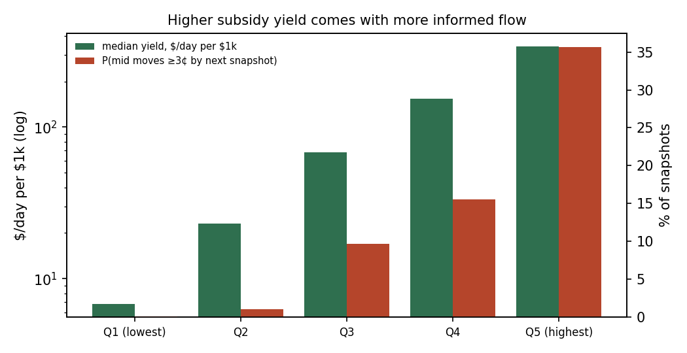
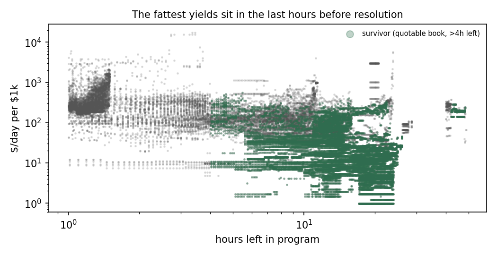

# Kalshi pays $10k an hour for liquidity. Most of it is bait.

*Blake Hurst · September 2026 · data and code in this repo*

Kalshi runs a Liquidity Incentive Program (LIP): it pays people to keep resting bids near the top of the book. I built a recorder to find out where that money actually goes and whether a small account can collect it without getting picked off. Over 41.7 hours it captured 69,450 order-book snapshots across 1,924 markets.

**TL;DR**

- The pool is real and growing. On 2026-08-21 the program list showed 4,515 programs paying $4,490/hr in total. On 2026-09-22 it showed 4,968 programs paying $10,218/hr, **2.3× in a month**.
- **Most of it isn't collectable.** 54% of snapshots were markets that were already decided (a best bid ≤5¢ or ≥95¢) and 12% were one-sided. Only **22%** were books you could sensibly quote into, and those came from just 88 events.
- **Yield and informed flow move together.** Rank snapshots by the subsidy yield a quote would earn. In the top fifth, the mid moves 3¢ or more before the next snapshot (about 5 minutes later) **36%** of the time. In the bottom two fifths that almost never happens (≤1%). The rank correlation between yield and next move is 0.54.
- The high yields sit where the program is about to end (a median of 1.6 hours left) and the book is nearly empty (a median 57¢ spread). The subsidy is paying you to stand in front of people who know the answer.

## How the program pays

From Kalshi's CFTC rule filing (July 2026 update) and help center:

1. Once a second, at a random moment, Kalshi snapshots each incentivized market.
2. For each side it walks down from the best bid **one whole price level at a time**. The level where the running size reaches **⅕ of the target size** becomes the *reference price*. The walk stops at the level where the running size reaches the **target size**, and nothing past that level counts.
3. Bids at or above the reference price score their full size. Bids below it are scored at `discount^ticks`.
4. Your share of the snapshot is your yes-side share plus your no-side share. The period reward is split by summed snapshot scores, and payouts under $1.00 per period aren't made.

Two consequences that aren't obvious until you code it:

- **Queue position doesn't matter, and for small quotes improving by a tick buys nothing.** Levels count whole, so the back of a 3,000-lot level scores the same as the front. If your size is under ⅕ of the target and the best level already sits at or above the reference price, bidding one tick higher earns the same score. The only thing it buys is getting filled first. (`tests/test_scoring.py::test_real_book_improving_price_buys_no_extra_score` uses a real book to show this.) A quote of ⅕ of the target or more is different: stepping in front pulls the reference up to your price and discounts everyone behind you. On that same book, a target-size quote goes from 25% of the side to 100% by improving one tick.
- **Thin sides are where share concentrates.** If a side's best level is tiny, a target-size quote there can reach the target by itself. The walk then stops at your level and you own almost the whole side. Thin sides are also exactly where the informed traders are.

## The recorder

`lip/recorder.py` runs every ~5 minutes on a small DigitalOcean VPS under systemd. Each sweep:

1. Pulls the active liquidity programs.
2. Takes the 150 top payers by reward rate.
3. Fetches each market's book.
4. Scores both sides as if I had quoted target size at the best bid on each side.

It writes one Parquet file per sweep. The client can only send GET requests: there is no order code in the repo.

The dataset here (`data/`, 2026-09-23 23:19 to 2026-09-25 17:04 UTC) came from the first version of the recorder. That version was simpler than the filed rule in two ways: it didn't stop the walk at target size, and it used the *smaller* of the two side shares. Both choices understate your share, and the hypothetical quote only joins the best bid and never improves it, so the yields below are conservative on share. They are *not* conservative on risk: they ignore fills and adverse selection entirely. The code in this repo implements the filed procedure exactly and records both share measures.

## Finding 1: most snapshots aren't quotable

| Book state | Share of snapshots |
|---|---|
| Already decided (either best bid ≤5¢ or ≥95¢) | 54.1% |
| One-sided (a side has no bids) | 11.7% |
| Both sides already at target depth | 71.0% |
| **Quotable**: both sides at target depth, not decided, >4h left, reference within 2 ticks of the best bid | **21.9%** |

The categories overlap, so they don't sum to 100%.

The quotable snapshots cover 292 markets in 88 events. A third of them are Rotten Tomatoes score markets (`KXRT`). The rest are mostly MLB season win totals, NFL player-prop ladders, Trump approval, and a Strait of Hormuz series.

## Finding 2: yield tracks informed flow

These are live, two-sided books, ranked into quintiles by the yield a target-size quote would earn. The move is the absolute change in mid at that market's next snapshot, a median of 5.3 minutes later.

| Yield quintile | Median yield, $/day per $1k posted | P(mid moves ≥3¢) | Median hours left | Median spread | Quotable |
|---|---|---|---|---|---|
| Q1 (lowest) | $6.79 | 0% | 17.0 | 1¢ | 95% |
| Q2 | $23.04 | 1% | 14.3 | 1.7¢ | 86% |
| Q3 | $67.88 | 10% | 10.5 | 8.7¢ | 34% |
| Q4 | $154.61 | 16% | 6.7 | 12¢ | 23% |
| Q5 (highest) | $341.90 | 36% | 1.6 | 57¢ | 7% |



The $342/day per $1k in Q5 is an illusion. It's paid on nearly empty books in the last hours before resolution. Anyone who knows the outcome, or has seen the number before you, fills you there. One adverse 3¢ move on a $1k target-size quote costs about $30, which is 1–4 days of subsidy at Q1–Q2 yields.



## Finding 3: what's left is small, boring, and concentrated

Count yield only while a book is quotable and keep the best market per event. That leaves **25 events** with a market paying at least $10/day per $1k and quotable at least half the time. The leaders are gas and diesel price markets and daily Trump approval brackets, at roughly $60–140/day per $1k before fills. These are slow, scheduled, data-driven markets where the answer arrives at a known time, which makes it possible to step out beforehand.

## What I'm doing with it

I'm running a live test on one Rotten Tomatoes market, with rules written down before it starts:

- Quote both sides at the touch, 10 contracts each.
- Never quote a side priced ≥95¢.
- Re-read the live book before every placement.
- Pull everything the day reviews post.

Day 0 went wrong: I placed off a stale price, crossed the spread and paid taker. That's why the re-read rule exists. The kill-or-scale call comes after day 7 (2026-10-04), and I'll post the P&L, subsidy earned against adverse fills, either way.

## Limitations

- 41.7 hours (Sept 23–25). The pool composition shifts with the sports and news calendar.
- The top-150-by-reward selection over-samples the high payers, which is the population a yield-chaser would target anyway.
- A mid move is a proxy for adverse selection, not measured P&L. Real fills would tell more, and the live test is where they come from.
- Yields are gross and assume nobody else adds size when you arrive.

## Reproduce

```bash
pip install -r requirements.txt
python analysis/report.py          # prints every table above, redraws docs/*.png
python -m pytest -q                # scoring rules, parsing, recorder, GET-only guard
```

Sources: Kalshi, *Liquidity Incentive Program* (CFTC rule filing, July 15 2026 update), https://www.cftc.gov/filings/orgrules/rules07152610358.pdf; Kalshi Help Center, *Liquidity Incentive Program*, https://help.kalshi.com/en/articles/13823851-liquidity-incentive-program; Kalshi API reference, `GET /incentive_programs`, `GET /markets/{ticker}/orderbook`.
